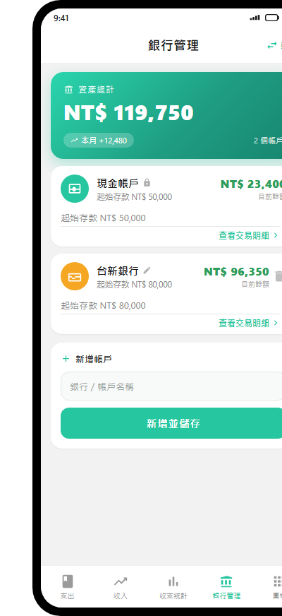
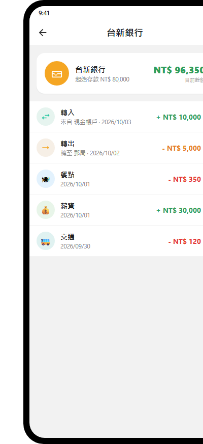
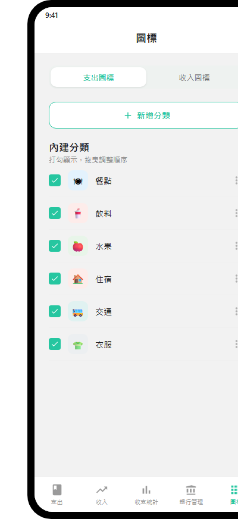
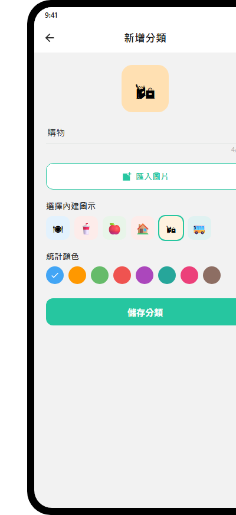
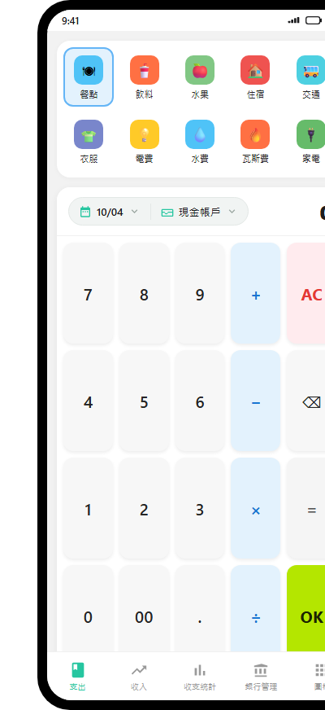
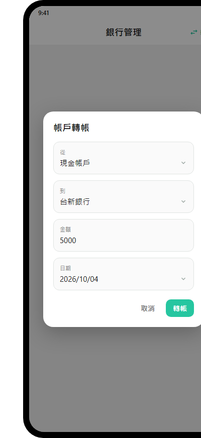
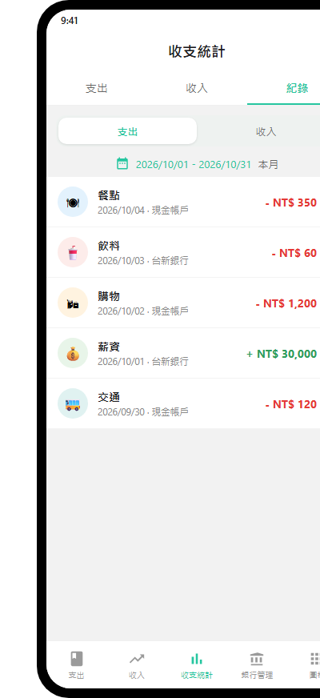
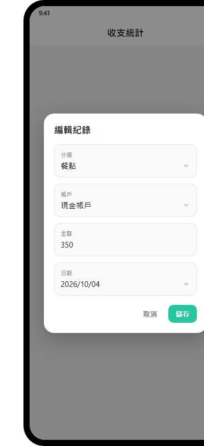

# 記帳 App 操作教學

這份教學涵蓋本記帳 App 的五大常用功能：銀行帳戶設定、常用圖標設定、支出／收入輸入、銀行轉帳，以及收支紀錄編輯。

## 導覽：畫面下方的五個頁籤

| 頁籤       | 用途                         |
| -------- | -------------------------- |
| **支出**   | 輸入一筆支出（選分類、日期、付款方式、金額）     |
| **收入**   | 輸入一筆收入（操作與支出相同）            |
| **收支統計** | 查看支出／收入統計，以及「紀錄」清單（可編輯／刪除） |
| **銀行管理** | 管理帳戶與存款、帳戶間轉帳、查看帳戶交易明細     |
| **圖標**   | 設定常用分類圖標（顯示／隱藏、排序、自訂）      |

***

## 1. 銀行管理：設定存款與銀行帳戶

### 1.1 進入銀行管理

點下方最右側（第四個）頁籤 **「銀行管理」**。

### 1.2 認識頁面

* 最上方為 **「資產總計」** 卡片：顯示所有帳戶合計的總資產、本月收支變動、帳戶數。

* 下方是帳戶清單，每個帳戶一張卡片，顯示 **帳戶名稱、起始存款、目前餘額**。

* **目前餘額 ＝ 起始存款 ＋ 收入 − 支出 ＋ 轉入 − 轉出**。

### 1.3 新增銀行帳戶

1. 捲到最下方「**新增帳戶**」卡片。

2. 在「銀行／帳戶名稱」欄位輸入帳戶名稱（例如「台新銀行」「郵局」）。

3. 點「**新增並儲存**」按鈕，帳戶即加入清單。

> 提示：點「新增並儲存」時，也會一併把你其他帳戶未儲存的修改存起來。

### 1.4 設定存款（起始存款）

* 點任一帳戶卡片內的「**起始存款**」欄位，輸入金額後點「**新增並儲存**」。

* 帳戶名稱與起始存款會儲存；「目前餘額」會依照收入／支出／轉帳自動增減。

### 1.5 修改銀行帳戶名稱

* 直接點銀行帳戶卡片上的名稱欄位即可修改文字，再點「新增並儲存」。

### 1.6 刪除銀行帳戶

1. 點該銀行卡片右上角的**垃圾桶圖示**。

2. 系統會跳出確認視窗，點「**刪除**」即移除。

3. 若此帳戶已有交易紀錄，會提示「既有紀錄仍會保留，但改以『付款方式』顯示」。

> 注意：
>
> **「現金帳戶」是固定的**
>
> ，名稱無法修改、也不能刪除（會顯示一個小鎖頭圖示）。

### 1.7 查看帳戶交易明細

* 點帳戶卡片下方的「**查看交易明細 ›**」（或點卡片標題列），進入該帳戶的明細頁。

* 明細頁顯示：目前餘額、起始存款，以及該帳戶的**收支紀錄**與**轉帳**（轉入顯示 `+`、轉出顯示 `-`），依日期排序。

* 明細頁內可透過每筆右側的選單（⋮）**刪除**該筆紀錄或轉帳。

***

## 2. 設定常用圖標

「圖標」頁用來管理支出／收入頁上顯示的分類圖示，可顯示／隱藏、排序、新增與編輯自訂分類。

### 2.1 進入圖標設定

點下方最後一個頁籤 **「圖標」**。

### 2.2 切換支出／收入分類

* 頁面上方有「**支出圖標**」與「**收入圖標**」兩個按鈕，點擊切換要管理的分類類型。

### 2.3 顯示／隱藏分類

* 每個分類左側有**勾選框**：打勾＝在支出／收入頁的圖示清單中**顯示**；取消勾選＝**隱藏**（統計仍會保留，只是不顯示在輸入頁）。

### 2.4 調整順序（常用放前面）

* 每個分類右側有**拖曳把手（≡）**。按住並上下拖曳即可調整順序。

* 建議把**常用分類排在前面**，輸入時更容易點到。

### 2.5 新增自訂分類

1. 點「**新增分類**」按鈕。

2. 在編輯頁：

* 輸入**分類名稱**（最多 20 字）。

* 點「**匯入圖片**」從電腦挑選圖片，或從下方「選擇內建圖示」挑一個內建圖示。

* 在「**統計顏色**」挑一個顏色（用於統計圖與進度條）。

1. 點「**儲存分類**」。

2. 新分類會出現在「自訂分類」區塊，並自動加入支出／收入頁的圖示清單。

### 2.6 編輯／刪除自訂分類

* 在「自訂分類」區塊：

  * 點分類本身 → 進入編輯頁修改名稱／圖示／顏色。

  * 點分類右側的 **⋮ 選單** → 選「編輯」或「刪除」。

> 說明：內建分類只能顯示／隱藏與排序，不能改名或刪除；自訂分類才能編輯與刪除。刪除分類後，既有紀錄與統計仍會保留。

***

## 3. 輸入支出與收入

支出與收入的輸入方式完全相同，差別只在分類與正負。

### 3.1 進入支出／收入

* 點下方 **「支出」** 頁籤輸入支出；點 **「收入」** 頁籤輸入收入。

### 3.2 選擇分類

* 畫面上方是分類圖示清單（即「圖標」頁設定顯示的分類）。

* 點一下要使用的分類（例如「餐點」），選中的分類會以藍色外框標示。

### 3.3 設定日期

* 點上方「**日期**」膠囊（顯示如 `10/04`，帶日曆圖示）。

* 在日期選擇器選好日期後按確定。

### 3.4 選擇付款方式（記入哪個帳戶）

* 點「**付款方式**」膠囊，從下拉清單選擇帳戶（現金帳戶、各銀行帳戶）。

* 若未選擇，預設會記入 \*\*「現金帳戶」\*\*。

* 此帳戶會決定該筆收支影響哪個帳戶的餘額。

### 3.5 輸入金額（計算機鍵盤）

* 使用下方數字鍵盤輸入金額：

  * 數字鍵 `0–9`、`00`、小數點 `.`。

  * 運算子 `+ − × ÷` 與 `=`：可以輸入算式，例如 `100 + 50 =` 會算出 `150`。

  * `AC`＝全部清除、`⌫`＝退格、`=`＝計算。

* 金額顯示在最右側。

### 3.6 完成輸入

* 點右下角綠色的 `OK` 按鈕完成輸入。

* 會跳出「已記錄」的提示，這筆紀錄即加入，並同步更新所選帳戶的餘額與收支統計。

***

## 4. 銀行轉帳功能

在多個帳戶之間移動金錢，例如從「現金」轉到「台新銀行」。

### 4.1 開啟轉帳

1. 進入 **「銀行管理」** 頁籤。

2. 點右上角的「**轉帳**」按鈕。

> 前提：至少要有
>
> **兩個帳戶**
>
> 才能轉帳（現金帳戶 + 至少一個銀行帳戶）。

### 4.2 填寫轉帳

在轉帳對話框：

1. **從**：選擇轉出的帳戶（金額由此帳戶扣減）。

2. **到**：選擇轉入的帳戶（金額加入此帳戶；系統會自動避免「從」與「到」相同）。

3. **金額**：輸入要轉帳的金額。

4. **日期**：可調整轉帳日期（預設今天）。

5. 點「**轉帳**」完成。

### 4.3 轉帳後的影響

* 轉出帳戶的「目前餘額」**減少**；轉入帳戶的「目前餘額」**增加**。

* **不會**被計入收支統計的支出或收入（轉帳不屬於收支），因此不會影響「資產總計」與每月收支變動。

### 4.4 查看與刪除轉帳

* 進入任一帳戶的「**查看交易明細**」，會看到標示「**轉入**」或「**轉出**」的紀錄（例如 `轉入 · 來自 現金帳戶`）。

* 點該筆右側 **⋮ 選單** →「刪除轉帳」，可撤銷該筆轉帳（兩邊餘額會回復）。

***

## 5. 收支編輯功能

### 5.1 進入紀錄清單

1. 點下方 **「收支統計」** 頁籤。

2. 點頁面頂部 **「紀錄」** 頁籤。

### 5.2 篩選與瀏覽

* 可用「**支出／收入**」按鈕切換只看支出或收入。

* 可用上方日期範圍挑選，或點「**本月**」快速回到本月。

* 清單中每筆顯示：分類圖示、分類名稱、日期與所屬帳戶、金額（收入綠色 `+`、支出紅色 `-`）。

### 5.3 編輯紀錄

1. 點該筆紀錄右側的 **⋮ 選單** → 選「**編輯**」。

2. 在編輯對話框可修改：

* **分類**（支出／收入分類下拉）。

* **帳戶**（付款方式，改動會影響餘額歸屬）。

* **金額**。

* **日期**。

1. 點「**儲存**」完成修改，統計與帳戶餘額會同步更新。

### 5.4 刪除紀錄

1. 點該筆紀錄右側的 **⋮ 選單** → 選「**刪除**」。

2. 跳出確認視窗後點「**刪除**」，該筆紀錄即移除，帳戶餘額與統計同步還原。

### 5.5 其他編輯入口

* 在「銀行管理 → 查看交易明細」的明細頁，也可對該帳戶的收支紀錄與轉帳進行**刪除**。

* 收支的**完整編輯**（分類、帳戶、金額、日期）以「收支統計 → 紀錄」為主要入口。

***

## 小提醒

* **餘額自動計算**：各帳戶的「目前餘額」會隨收支與轉帳自動增減，不需手動改（起始存款除外）。

* **資料自動儲存**：新增／編輯／刪除收支、轉帳、帳戶，皆會自動儲存，重開 App 仍會保留。

* **現金帳戶固定**：不可改名、不可刪除，用以確保永遠有至少一個付款方式。

* **轉帳不影響統計**：帳戶間移轉金錢不會被當成收入或支出。